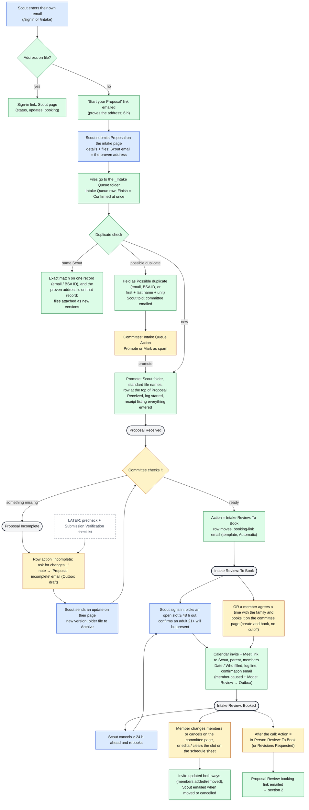
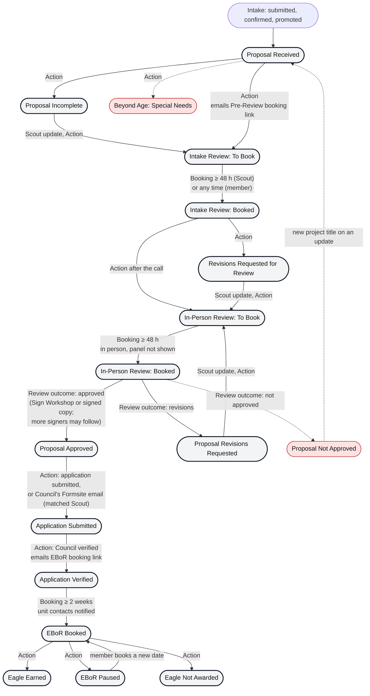

# Process flow: Coyote Creek Eagle Tracker

How a Life Scout's Eagle Project Proposal moves through the committee, **as the code works today** (API 0.61, 2026-11-10).
Terms are defined in the [glossary](glossary.md); the stages are the sections of the tracking sheet described in the
[overview](overview.md). (The `.drawio` files are early sketches from 2026-10-16 of the process before the tool; they are not kept up to date.)

**Legend:** 🟦 Scout / parent · 🟨 Committee member · 🟩 Tool (automatic) · ⬜ Sheet section (status) · dashed = later

## 1. Intake → Pre-Review Call (detail)

## 2. Whole pipeline (sections)

**Action** = a committee member picks the next section from the row's Action dropdown; **Booking** = the tool moves
the row when a booking is made (by the Scout or a member); cancelling moves it back to To Book.

Online booking per type follows Settings → `onlineBooking` (production: `all` since 2026-10-26); a type not online
would be scheduled by the committee (committee page or schedule sheet) and the Scout's page says so. The committee can
always book a Scout itself (create and book), and a session may carry its own lead time.

## 3. Emails along the way

Emails about a Scout go **To the Scout, Cc the parent/guardian** and the committee group.

| Moment | Email | Class |
|---|---|---|
| Submit / confirm / update | Confirm link, receipt (everything entered), update receipt | A automatic |
| Row moved to a To Book stage | "Book your <session>" | B (template Mode decides) |
| Still not booked after Settings `pleaseBookDays` (default 7 / 14 days; EBoR 7) | 6.2.c Please book | Outbox draft |
| Status + page link (Action) | Status email | B (Mode: Review → Outbox) |
| Committee adds sessions | Open-times email: one email To all Scouts ready to book that type, Cc parents + committee | Outbox draft |
| Booked / moved / cancelled | Confirmation + Calendar invite / update / cancellation | A when the Scout did it; B when a member did (Outbox if the tab says Review) |
| The day before a session | 6.2.b Session briefing to the members on the slot | automatic |
| Approved with more signatures to come | The signed-so-far copy to the next signer(s), now or as an Outbox draft | B |
| Review outcome / dashboard row actions | Approved, revisions, not approved, application acknowledgement, EBoR next steps, EBoR paused, not awarded, Council paperwork, New Eagle Scout | Outbox draft |
| EBoR booked / moved / cancelled | One email To the Scout **and** the unit contacts (4.1.a / b / c), Cc parent + committee | A when the Scout did it; B when a member did |
| EBoR in 7 days, no Unit Board Members | 4.1.h to the unit contacts | Outbox draft |
| 3 days before an EBoR | 4.3.c one reminder to the Scout and the board (Cc parent + committee) | Outbox draft (Send later) |
| Daily | Committee digest (Awaiting action, next 7 days, changes); health check to the admin | C system |

Full list: Admin → Templates: rebuild catalog (the "Eagle Tracker email catalog" Sheet); every email can be previewed
and test-sent to yourself on the Admin page. Design note (kept outside the repo).
